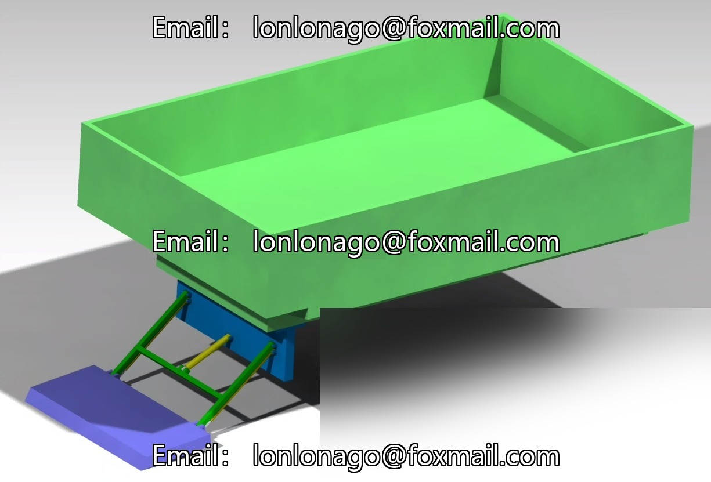
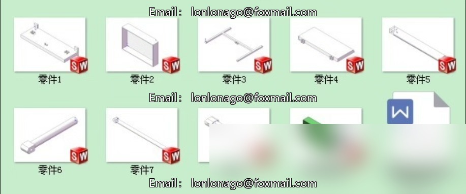

# Vehicle crane end plate design for load-carrying vehicles; vehicle crane end plate design; vehicle end plate design; automobile end plate design.

## Body

Hitchback design for truck; vehicle hitchback design; vehicle tailback design; vehicle tailback design diagram; vehicle tailback design CAD diagram; vehicle raised tailback design; vehicle loading/unloading tailback design; vehicle raised loading/unloading tailback design diagram; 191. This design includes design descriptions and three-dimensional diagrams.

The content covers the heavy-duty car's rear plate design, including design descriptions, 3D diagrams, parts, mechanical selection, scale analysis, motion and force analysis, and conclusions.

<!-- AI_ENRICHED -->

## Images

## Payment

Here is a pay link on Stripe ( https://buy.stripe.com/3cs8yP7sY87d0vu9AB ). Please contact me lonlonago@foxmail.com after funding $89, and I will send you a complete data files , thank you!

